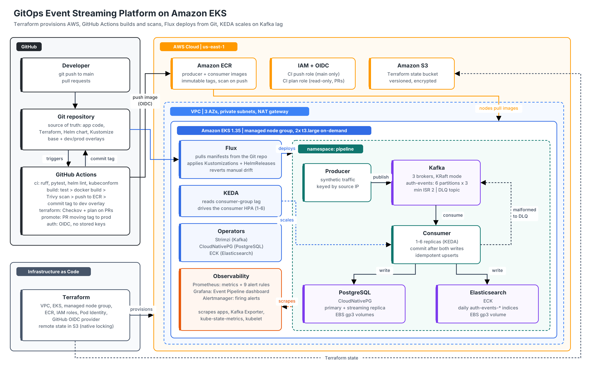
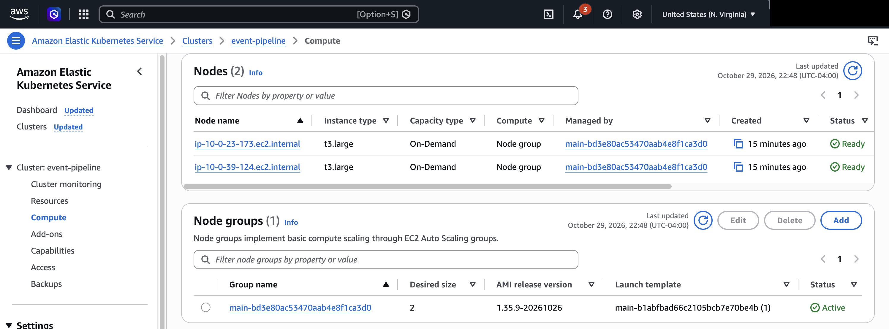
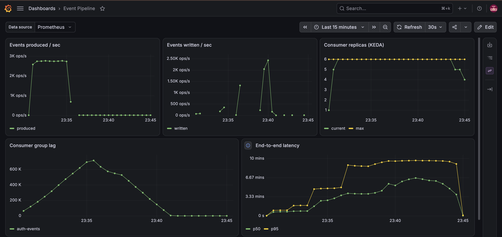
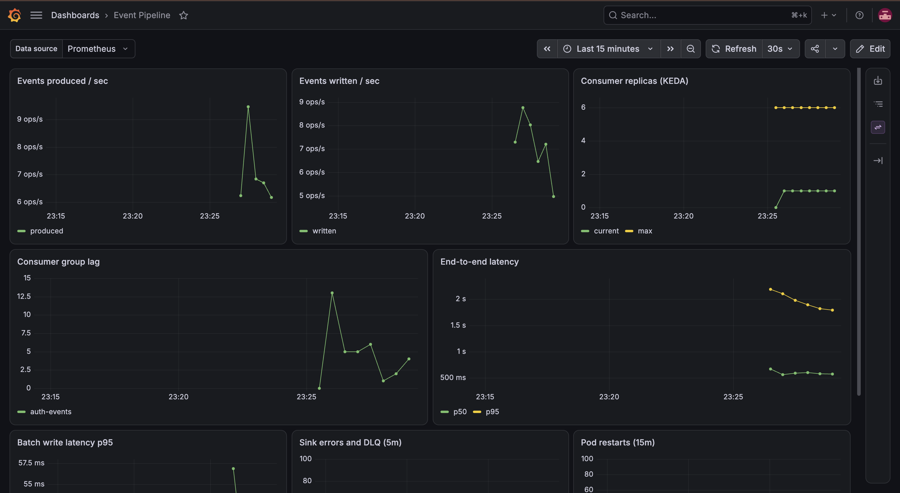
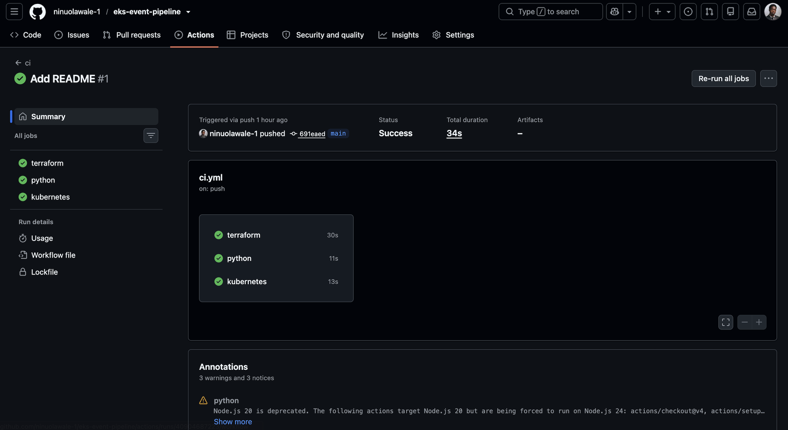
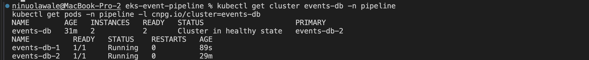
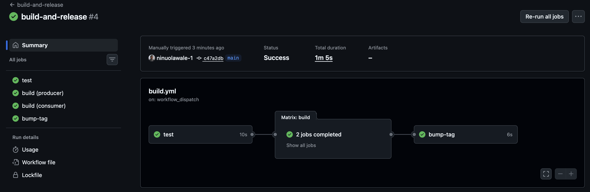

# GitOps Event Streaming Platform on Amazon EKS



## Platforms and Languages Leveraged
- Amazon Web Services (EKS, EC2, EBS, ECR, VPC, IAM, S3, EKS Pod Identity, Service Quotas)
- Terraform (HashiCorp Configuration Language), AWS Provider 6.x, terraform-aws-modules (EKS v21, VPC v6)
- Kubernetes 1.35 (Helm, Kustomize, HPA, PodDisruptionBudgets, Pod Security Standards)
- Flux (GitOps, HelmReleases, drift detection)
- KEDA (event-driven autoscaling on Kafka lag)
- Apache Kafka via Strimzi, PostgreSQL via CloudNativePG, Elasticsearch via ECK
- Prometheus, Grafana, Alertmanager (kube-prometheus-stack)
- GitHub Actions (OIDC federation), Trivy, Checkov, kubeconform
- Python 3.12, Bash, Docker, Make, Git

## Scenario

The goal of this project was to run a stateful, multi-component platform on Kubernetes the way a platform team would: every piece defined in code, every change delivered through Git, and the system able to scale and recover without someone manually intervening. A lot of Kubernetes demos stop at a single stateless web app deployed with `kubectl apply`. They don't deal with databases that need failover, message queues that need replication, workloads that need to scale on something other than CPU, or the question of how a change actually gets from a commit to a running cluster safely.

This platform streams events through a three-broker Kafka cluster into PostgreSQL and Elasticsearch on Amazon EKS. A Python consumer scales on Kafka consumer-group lag, writes to both stores idempotently, and only commits its progress once both writes succeed. Flux keeps the cluster in sync with this repository and reverts manual changes. GitHub Actions tests, scans, and builds every change, posts Terraform plans on pull requests, and deploys to dev automatically, while prod only changes through a reviewed pull request. No long-lived AWS credentials exist anywhere in the setup.

### High-Level Build Plan

- **Provision** the VPC, EKS cluster, ECR repositories, and IAM roles in Terraform, with state stored remotely in S3.
- **Connect** GitHub Actions to AWS through OIDC, with separate least-privilege roles for pushing images and planning infrastructure.
- **Deploy** Kafka, PostgreSQL, and Elasticsearch through Kubernetes operators, all managed by Flux from Git.
- **Build** a producer and consumer in Python with at-least-once delivery, idempotent writes, and a dead-letter topic.
- **Scale** the consumer on Kafka lag with KEDA instead of CPU.
- **Observe** the platform with Prometheus metrics, a Grafana dashboard, and alert rules backed by runbooks.
- **Separate** dev and prod with Kustomize overlays and a pull-request-based promotion workflow.
- **Validate** the platform by breaking it on purpose.

---

## Steps Taken

### 1. Provisioned the Platform in Terraform

Defined a three-AZ VPC with private subnets for worker nodes, a single NAT gateway to keep costs down, and an EKS cluster running Kubernetes 1.35 with a managed node group of two on-demand `t3.large` instances. Terraform state lives in an S3 bucket created by a separate bootstrap stack, with native S3 locking, so local runs and CI read the same state.

The EBS CSI driver, which every database and Kafka volume depends on, authenticates through EKS Pod Identity rather than a role attached to the nodes. That keeps storage permissions scoped to the one pod that needs them instead of every pod on the node.

```hcl
    aws-ebs-csi-driver = {
      pod_identity_association = [{
        role_arn        = aws_iam_role.ebs_csi.arn
        service_account = "ebs-csi-controller-sa"
      }]
    }
```

Getting the first apply through took several rounds of troubleshooting:

- **Credentials expired mid-apply.** The temporary session from `aws login` expired while EKS was still creating, so Terraform couldn't save its state or release its lock. I pushed the saved `errored.tfstate` back to S3, released the stale lock with `force-unlock`, and cleared the cluster's tainted flag so Terraform stopped trying to create a duplicate.
- **The node group hung with no error.** It sat in `CREATING` for 30 minutes with no Auto Scaling group and no EC2 instances. Checking Service Quotas showed the account was capped at 5 vCPUs, and three 2-vCPU nodes need 6. I dropped to two nodes and requested a quota increase.
- **On-demand launches were rejected.** The retry failed with `InvalidParameterCombination: not eligible for Free Tier`. The account was on the AWS Free plan, which only allows Free Tier instance types. Upgrading to the paid plan fixed it.

**Deployed resources in AWS.**



### 2. Replaced Stored Credentials With OIDC Federation

GitHub Actions authenticates to AWS with short-lived OIDC tokens instead of access keys. There are two roles, and each trusts a different kind of workflow run. The push role only accepts tokens from the `main` branch and can only push to the two ECR repositories. The Terraform plan role only accepts tokens from pull requests and has read-only access, so a pull request can show what would change but can never change anything.

The first build failed with `Not authorized to perform sts:AssumeRoleWithWebIdentity`. The trust policy expected the classic subject format, `repo:OWNER/REPO`, but this repository sends GitHub's newer **immutable subject**, which embeds numeric IDs for the owner and repo (`repo:OWNER@ID/REPO@ID`). Those IDs survive renames, so a deleted repo name can't be re-registered and inherit the trust. I made the subject prefix a Terraform variable so both roles match what GitHub actually sends.

```hcl
  github_sub_prefix = (
    var.github_oidc_sub_prefix != ""
    ? var.github_oidc_sub_prefix
    : "repo:${var.github_owner}/${var.github_repo}"
  )
```

```hcl
  values = ["${local.github_sub_prefix}:ref:refs/heads/${var.github_branch}"]
```

### 3. Deployed Stateful Services Through Operators, Managed by Flux

Rather than hand-writing StatefulSets, each data service runs under an operator that handles its day-two operations: Strimzi for Kafka, CloudNativePG for PostgreSQL, and ECK for Elasticsearch. Flux installs them in dependency order. A default encrypted gp3 StorageClass comes first, then the operators and monitoring stack, then the pipeline itself, so custom resources are never applied before their CRDs exist.

Kafka runs three brokers in KRaft mode with `min.insync.replicas=2`, so the cluster keeps accepting writes with one broker down. PostgreSQL runs a primary and a streaming replica with automatic failover.

```yaml
spec:
  dependsOn:
    - name: infra-configs
    - name: infra-controllers
  path: ./platform/apps/overlays/dev
  prune: true
  wait: true
```

Once Flux synced, the data services came up, but the producer and consumer releases were rejected. Because the Helm chart is pulled straight from Git, Flux appends the commit to the chart version (`0.1.0+e2fd74d44688`). The chart used that version in its `helm.sh/chart` label, and Kubernetes doesn't allow `+` in labels. Sanitizing the label fixed both releases.

```yaml
helm.sh/chart: {{ printf "%s-%s" .Chart.Name .Chart.Version | replace "+" "_" | trunc 63 | trimSuffix "-" }}
```

### 4. Built the Producer and Consumer for Failure

The producer generates synthetic traffic and keys each message by source IP, so related events always land on the same partition and stay in order. The consumer enriches each batch, writes it to PostgreSQL and Elasticsearch, and only then commits its Kafka offsets. If either sink is down, nothing is committed. The consumer retries with backoff and, if the sink stays down, exits so Kubernetes restarts it from the last committed offset.

Because that design means some messages get processed twice, both writes are idempotent. Postgres ignores conflicting event IDs, and Elasticsearch uses the event ID as the document ID. Malformed messages go to a dead-letter topic instead of blocking the stream.

```python
with_retries("postgres", lambda batch=events: self._write_postgres(batch))
with_retries("elasticsearch", lambda batch=events: self._write_elasticsearch(batch))
...
self.consumer.commit(asynchronous=False)
```

### 5. Autoscaled the Consumer on Kafka Lag With KEDA

The consumer spends most of its time waiting on network writes, so its CPU can look idle while it falls further and further behind. Scaling on CPU would miss that completely. KEDA scales it on consumer-group lag instead, targeting 200 messages of lag per replica.

The maximum is six replicas, matching the topic's six partitions, because Kafka assigns each partition to at most one consumer in a group and any extra consumers would sit idle. Scale-down is limited to one pod per minute so a brief dip in lag doesn't trigger a string of consumer-group rebalances.

```yaml
  triggers:
    - type: kafka
      metadata:
        consumerGroup: "auth-event-consumer"
        topic: "auth-events"
        lagThreshold: "200"
```

Flux's drift detection is enabled on both apps, so a manual `kubectl scale` or `kubectl set env` gets reverted to what Git says. The consumer's replica count is the one field excluded, since KEDA owns it.

**Load test (`make load-test`).** Four producers pushed about 2,750 events per second while each consumer batch was slowed to simulate heavier processing. Lag climbed past 700,000 messages, and KEDA scaled the consumer from 1 to 6 replicas within about a minute, which is the cap set by the topic's six partitions. Once the load stopped, the six consumers drained the backlog to zero in roughly five minutes, and KEDA scaled them back down one pod at a time.



### 6. Added Observability and Alerting

Both apps expose Prometheus metrics, including throughput, batch write time, sink errors, dead-letter count, and an end-to-end latency histogram measuring the time from event creation to landing in both stores. The Strimzi Kafka Exporter adds consumer-group lag. A Grafana dashboard, provisioned from a ConfigMap in Git, shows all of it alongside the current consumer replica count.

Nine alert rules cover the failures that matter most, and each one links to a runbook section that explains how to check and fix it.

```yaml
        - alert: PipelineStalled
          expr: |
            sum(rate(events_produced_total[5m])) > 0
              and sum(rate(events_consumed_total[5m])) == 0
          for: 5m
```

Under normal traffic (about 5 to 9 events per second), lag stays in the single digits, one consumer replica is enough, and end-to-end latency sits around 600 ms at p50 and about 2 seconds at p95.



### 7. Separated Environments and Gated Promotion

The pipeline is defined once in a Kustomize base, and dev and prod overlays layer on only what differs. Prod drops the synthetic producer, runs three Elasticsearch nodes and three PostgreSQL instances, keeps a minimum of two consumers, and retains Kafka volumes when the cluster is deleted.

Every merge to `main` runs tests, builds both images, scans them with Trivy, pushes them to ECR, and commits the new tag to the dev overlay, which Flux then rolls out. Promoting to prod is a separate workflow that copies the tested tag into the prod overlay and opens a pull request with a checklist, so prod only changes after review.

The Trivy step originally referenced a GitHub Action tag that no longer resolved, so both build jobs failed before starting. I switched to running Trivy from its official container image, which doesn't depend on the action's tag naming.

```yaml
  - patch: |-
      $patch: delete
      apiVersion: helm.toolkit.fluxcd.io/v2
      kind: HelmRelease
      metadata:
        name: producer
```

### 8. Reviewed Infrastructure Changes in Pull Requests

Any pull request that touches Terraform runs a Checkov scan and a `terraform plan` under the read-only role, then posts the plan as a comment on the PR. Infrastructure changes get reviewed the same way as application code, with the exact diff in front of the reviewer. A separate CI workflow lints the Python, runs unit tests, lints and renders the Helm chart with and without KEDA, and schema-validates every rendered manifest with kubeconform.



### 9. Validated Failover by Breaking It

Each design choice was tested by creating the situation it's meant to handle, not just by confirming the happy path works.

**PostgreSQL primary failover (`scripts/chaos-test.sh postgres`)**

I deleted the primary database pod while the consumer was actively writing. CloudNativePG detected the loss within a second and started a failover, then promoted the replica (`events-db-2`) once the old primary had fully stopped. The cluster was healthy again in about three minutes.

Most of that time was deliberate. CloudNativePG first attempts a smart shutdown, which waits for open client connections to close, and the consumer held one open. It also refuses to promote the replica until the old primary is gone, which prevents two databases from accepting writes at once. Faster failover would mean lowering `smartShutdownTimeout`, trading some safety for speed.



**Build and release run: test, build and scan both images, push to ECR, and commit the new tag**



---

## Platform Controls

| Control | Without it | With it | Validation |
|---|---|---|---|
| Database availability | Single Postgres pod | Primary + replica with automatic failover | Primary deleted under load: replica promoted, healthy in ~3 min |
| Pipeline credentials | Stored AWS access keys | OIDC roles scoped to `main` and to pull requests | No AWS secrets in the repo or GitHub settings; builds push to ECR through OIDC |
| GitOps delivery | `kubectl apply` by hand | Flux syncs the cluster from Git in dependency order | Operators, data services, and apps deployed from a single bootstrap |
| Image security | Unscanned images | Trivy scan blocks fixable critical CVEs before push | Scan runs on every build |
| Consumer scaling | Fixed replica count; falls behind under load | KEDA scales 1-6 replicas on Kafka lag | ~2,750 events/s: scaled 1 → 6 in about a minute, 700K+ lag drained in ~5 min |
| Kafka durability | Single broker; one failure stops writes | 3 brokers, replication factor 3, min ISR 2 | Not yet tested |
| Configuration drift | Manual changes persist silently | Flux drift detection restores Git state | Not yet tested |

---

## Timeline of Build Events

1. **Local Pipeline Built**: Producer and consumer running end to end with Docker Compose, with unit tests for the enrichment logic.
2. **Remote State Created**: S3 bucket for Terraform state, provisioned by a separate bootstrap stack.
3. **Platform Provisioned**: VPC, EKS, ECR, and IAM deployed with Terraform, after recovering from expired credentials mid-apply, a 5-vCPU account quota, and a Free plan instance restriction.
4. **OIDC Configured**: GitHub federated to AWS with no stored keys. The trust policy was updated to match GitHub's immutable subject format.
5. **CI/CD Wired Up**: Tests, Trivy scans, image builds, and automatic dev deploys on every merge. Trivy was moved from a broken action tag to its container image.
6. **GitOps Bootstrapped**: Flux installed; operators, monitoring, and the pipeline deployed from Git in dependency order. A chart label rejected by Kubernetes was fixed.
7. **Autoscaling Validated**: Load test at about 2,750 events per second; KEDA scaled the consumer to its six-replica cap and the backlog drained once load stopped.
8. **Failover Validated**: PostgreSQL primary deleted under load; the replica was promoted and the cluster recovered in about three minutes.

---

## Usage

```bash
# 1. Run locally
make local-up && make test

# 2. Provision AWS (account must be on the paid plan, not the Free plan)
aws login
make state                     # one-time S3 bucket for Terraform state
# create terraform/terraform.tfvars with github_owner, endpoint_public_access_cidrs,
# node sizing, and github_oidc_sub_prefix if the repo uses immutable OIDC subjects
make tf-init && make tf-apply

# 3. Wire up CI (sets GitHub variables), then build the first images
make configure
git push && gh workflow run build-and-release

# 4. Install Flux and let it deploy everything
export GITHUB_TOKEN=<classic token with repo scope>
./scripts/bootstrap-flux.sh <github-owner>
make status

# 5. Operate it, prove it, then tear down
make ui                       # Grafana, Prometheus, Alertmanager
make load-test
./scripts/chaos-test.sh postgres
make teardown
```

**Requirements:** an AWS account on the paid plan with at least 4 vCPUs of on-demand EC2 quota, admin access (Terraform creates IAM roles), AWS CLI v2, Terraform 1.10+, kubectl, Helm 3, the Flux CLI, the GitHub CLI, and Docker for local runs. Full setup and troubleshooting are in [docs/setup.md](docs/setup.md). The cluster costs roughly $0.30 an hour with two on-demand nodes.

---

## Summary

This project runs a stateful event streaming platform on Amazon EKS where every piece, from the VPC to the image tag running in each environment, is defined in code and delivered through Git. Kafka, PostgreSQL, and Elasticsearch run under their operators with replication and failover. The consumer scales on Kafka lag rather than CPU, commits progress only after both writes succeed, and handles replays without creating duplicates. Changes flow through tested, scanned, and reviewed pipelines, credentials are short-lived throughout, and both autoscaling and database failover were validated against the live cluster.

---

## Lessons Learned

- **Silent failures need a different kind of debugging.** The node group sat in `CREATING` for 30 minutes without an error. The clue was what was missing: no Auto Scaling group and no instances, which pointed to an account limit rather than a configuration problem.
- **Check account limits before the first apply.** A 5-vCPU quota and a Free plan restriction both blocked node launches. A quick look at Service Quotas and the account plan would have saved most of an afternoon.
- **Long-running applies need credentials that outlast them.** Temporary credentials expiring mid-apply left the state split between S3 and a local file. Recovering meant pushing the saved state, releasing the lock, and untainting the cluster, in that order.
- **Identity formats change.** GitHub's immutable OIDC subject embeds numeric IDs, so a trust policy written for the classic format rejected every login with no hint about why. Comparing what the role expected against what GitHub sent found it.
- **Generated values end up in unexpected places.** Flux appends the Git revision to chart versions, and that version flowed into a label where `+` isn't allowed. Anything derived from a version string should be sanitized before it becomes a label.
- **Partitions set the ceiling on scaling.** During the load test, KEDA hit six replicas within a minute and stayed there, because the topic has six partitions. Past that point, more consumers would sit idle, so handling more load means adding partitions first.
- **Safe failover isn't instant failover.** The Postgres failover took about three minutes because the operator waited for client connections to close and for the old primary to stop before promoting the replica. That delay is the price of never having two primaries accepting writes.
- **Health checks should watch the cluster, not a role label.** My first chaos script waited on the pod labeled "primary," which briefly doesn't exist during a failover, so the script exited early even though the failover succeeded.

---

## Next Steps

- Run the Kafka broker and drift tests, and repeat the load test with 12 partitions to compare drain time.
- Lower `smartShutdownTimeout` and measure how much faster failover gets.
- Turn TLS back on for Elasticsearch and switch Kafka clients to mTLS with per-application users and ACLs.
- Apply Terraform automatically on merge behind a GitHub Environment with required reviewers.
- Stand up the prod overlay on a second cluster instead of only rendering it.
