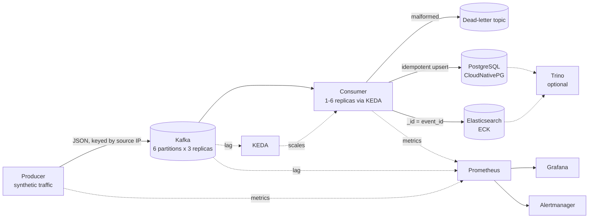
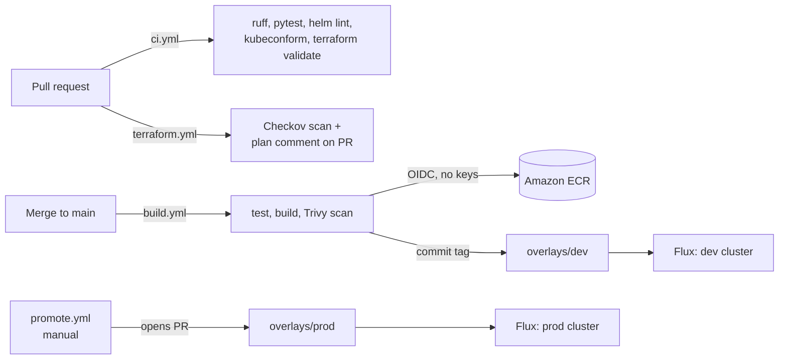

# Architecture

## Data flow

## Delivery path

## Repository structure and why

| Path | Purpose |
|---|---|
| `terraform/bootstrap` | One-time S3 state bucket (local state, kept between sessions) |
| `terraform/` | VPC, EKS, ECR, IAM. State in S3 so CI and local runs share it |
| `charts/pipeline-app` | One Helm chart for both services; KEDA ScaledObject is a chart option |
| `platform/infrastructure` | Cluster-wide pieces: operators, KEDA, Prometheus stack, StorageClass |
| `platform/apps/base` | The pipeline itself, environment-neutral |
| `platform/apps/overlays/{dev,prod}` | Per-environment image tags, sizing, and scaling limits |
| `clusters/{dev,prod}` | Flux entry points; each points at its overlay |

## Design decisions

**Why scale on Kafka lag instead of CPU?** The consumer spends most of its time waiting on Postgres and Elasticsearch. When it falls behind, CPU can look perfectly normal. Lag measures the thing that actually matters: how far behind real time the system is. KEDA turns lag into an HPA metric, so desired replicas is roughly total lag divided by the per-replica threshold.

**Why cap replicas at 6?** The topic has 6 partitions, and Kafka assigns each partition to at most one consumer in a group. A seventh consumer would sit idle. Scaling further means adding partitions first.

**Why slow scale-down?** Every consumer joining or leaving triggers a rebalance. The HPA behavior removes at most one pod per minute so a brief dip in lag doesn't cause rebalance churn.

**Why drift detection in Flux?** Without it, someone can `kubectl scale` or `kubectl set env` and the cluster quietly stops matching Git. With it, Flux reverts manual changes on the next reconcile. The one exception is the consumer's replica count, which KEDA owns.

**Why base + overlays?** Dev and prod run the same manifests. Only what genuinely differs (image tag, node counts, disk sizes, minimum replicas) lives in the overlay, so `make render` shows the exact delta between environments.

**Why promote through a pull request?** CI deploys every merge to dev automatically. Prod only changes when someone opens and merges a promotion PR, which gives you a review gate and an audit trail without any extra tooling.

**Why plan in CI with a separate read-only role?** Infrastructure changes get reviewed like application code: the plan is right there on the PR. The plan role can read everything but write nothing, and only pull requests from this repo can assume it. The push role is separate and only works from `main`.

**Why commit offsets manually?** The consumer commits only after both sinks accept a batch. If either is down, nothing is committed and the pod restarts from the last good offset. Both writes are idempotent (Postgres ignores duplicate `event_id`s, Elasticsearch uses `event_id` as the document ID), so replays never create duplicates.

**Why operators (Strimzi, ECK, CloudNativePG)?** Running stateful systems on Kubernetes is mostly day-2 work: rolling upgrades, failover, certificate rotation, volume handling. Operators encode that instead of hand-written StatefulSets.

## Known lab shortcuts (and the production fix)

| Shortcut | Production approach |
|---|---|
| Single NAT gateway | One NAT per AZ |
| Two on-demand nodes with little headroom | Separate node groups for stateful and stateless pods, with Karpenter or Cluster Autoscaler |
| Kafka nodes are combined controller+broker | Separate controller and broker node pools |
| Elasticsearch HTTP TLS disabled | Keep ECK's TLS and mount the CA in the consumer |
| Plain Kafka listener | TLS listener with mTLS `KafkaUser`s and ACLs |
| `terraform apply` run by hand | Apply on merge behind a GitHub Environment with required reviewers |
| Prod overlay not deployed | Second cluster (separate tfvars or workspace), bootstrapped at `clusters/prod` |
| Alerts only visible in Alertmanager | Route to Slack or PagerDuty with an Alertmanager receiver |
| Actions pinned to tags | Pinned to full commit SHAs |
